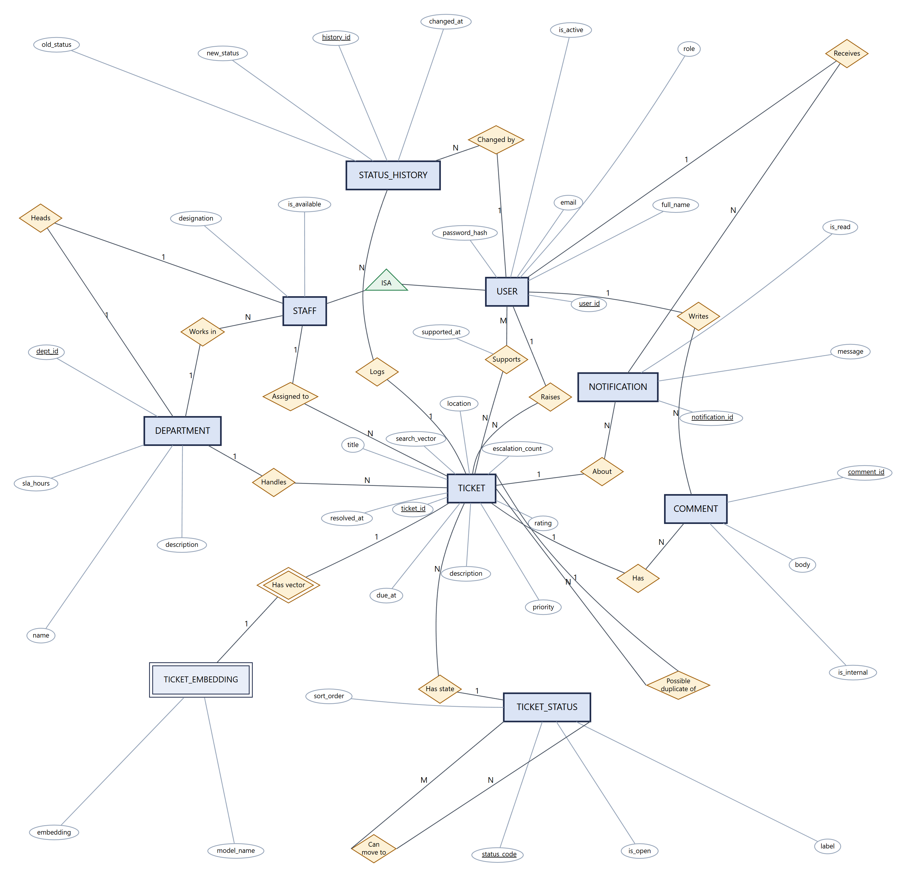
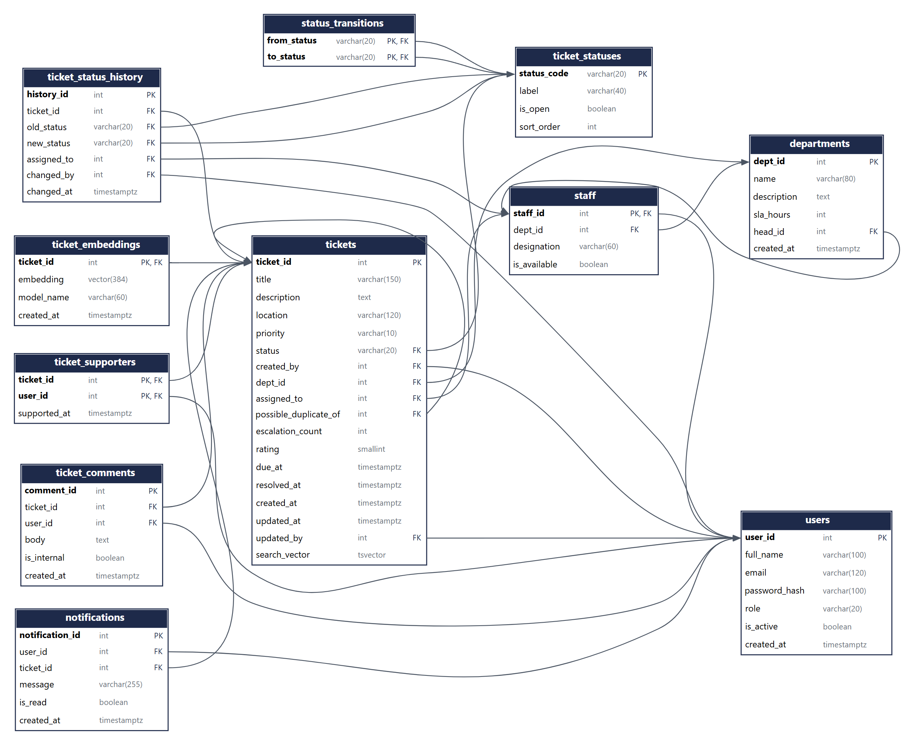
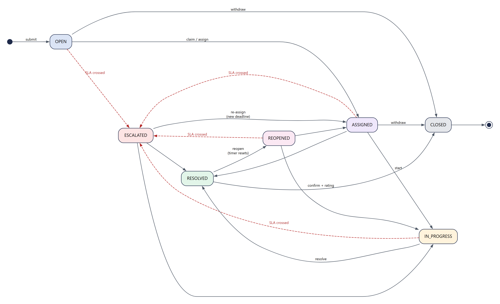

# Database design

This document covers the design of the Smart Grievance Redressal System database: why each database technology was chosen, the ER diagram, how it maps to tables, and how the rules are enforced. The vector part is explained in [VECTOR_SEARCH.md](VECTOR_SEARCH.md), and every column is listed in [DATA_DICTIONARY.md](DATA_DICTIONARY.md).

## 1. Database choice and justification

We used **Option 2 of the brief: SQL + vector database**, with PostgreSQL and the pgvector extension.

| Data | Nature | Stored in | Why |
|---|---|---|---|
| Users, departments, staff, tickets, history, comments, supporters | Structured, related, needs integrity | **PostgreSQL tables** | Foreign keys, CHECK constraints, transactions and row locks are needed. Two staff acting on one ticket must not both succeed, and a ticket must never point at a missing department. |
| Meaning of the complaint text | Unstructured natural language | **pgvector** | Complaints about the same issue are rarely worded the same way. "Lift not working" and "Elevator stuck" share no keywords, but their embeddings are close. |
| Exact words in the complaint | Text | **PostgreSQL full-text search** | Staff sometimes search for an exact word or room number, which keyword search does better. |

**Why pgvector and not a separate vector database.** The vectors are always used with relational filters, such as "only open tickets", joined to the department name. Keeping them in the same database means:

- one SQL query can do the similarity search together with the JOIN and WHERE filters,
- the vector is saved in the same transaction as the ticket, so a ticket is never stored without its embedding,
- there is one less service to run and keep in sync.

At our scale of thousands of tickets, a dedicated vector database would add complexity with no benefit.

**Why no NoSQL document store.** Our data has a fixed structure and every rule depends on relationships between records. A document store would move those rules into the application, which is exactly what this project is trying to avoid.

## 2. ER diagram

The diagram uses Chen notation: rectangles are entities, ovals are attributes (the key is underlined), diamonds are relationships, and double borders mark the weak entity and its identifying relationship. The triangle is the ISA specialisation.

### Entities

| Entity | Type | Key | Meaning |
|---|---|---|---|
| USER | Strong | user_id | Anyone who can log in |
| STAFF | Specialisation of USER | staff_id (same as user_id) | Staff and department heads |
| DEPARTMENT | Strong | dept_id | A department that handles complaints |
| TICKET | Strong | ticket_id | One complaint |
| TICKET_STATUS | Strong | status_code | One of the 7 workflow states |
| TICKET_EMBEDDING | Weak, depends on TICKET | ticket_id (from the owner) | Vector for a ticket. It has no key of its own |
| STATUS_HISTORY | Strong | history_id | One step in a ticket's timeline |
| COMMENT | Strong | comment_id | A comment on a ticket |
| NOTIFICATION | Strong | notification_id | An in-app message for a user |

### Relationships and cardinalities

| Relationship | Between | Cardinality | Stored as |
|---|---|---|---|
| ISA | USER, STAFF | 1 : 0..1 | `staff.staff_id` is both PK and FK |
| Works in | STAFF, DEPARTMENT | N : 1 | `staff.dept_id` |
| Heads | STAFF, DEPARTMENT | 1 : 1 | `departments.head_id` |
| Raises | USER, TICKET | 1 : N | `tickets.created_by` |
| Handles | DEPARTMENT, TICKET | 1 : N | `tickets.dept_id` |
| Assigned to | STAFF, TICKET | 1 : N | `tickets.assigned_to` |
| Has state | TICKET_STATUS, TICKET | 1 : N | `tickets.status` |
| Possible duplicate of | TICKET, TICKET | 1 : N (recursive) | `tickets.possible_duplicate_of` |
| Can move to | TICKET_STATUS, TICKET_STATUS | M : N (recursive) | table `status_transitions` |
| Supports | USER, TICKET | M : N, with attribute supported_at | table `ticket_supporters` |
| Has vector | TICKET, TICKET_EMBEDDING | 1 : 1 (identifying) | `ticket_embeddings.ticket_id` |
| Logs | TICKET, STATUS_HISTORY | 1 : N | `ticket_status_history.ticket_id` |
| Changed by | USER, STATUS_HISTORY | 1 : N | `ticket_status_history.changed_by` |
| Has | TICKET, COMMENT | 1 : N | `ticket_comments.ticket_id` |
| Writes | USER, COMMENT | 1 : N | `ticket_comments.user_id` |
| About | TICKET, NOTIFICATION | 1 : N | `notifications.ticket_id` |
| Receives | USER, NOTIFICATION | 1 : N | `notifications.user_id` |

## 3. ER to relational mapping

| ER element | Rule applied | Result |
|---|---|---|
| Strong entities | Each becomes a table, with its key as the primary key | `users`, `departments`, `tickets`, `ticket_statuses`, `ticket_status_history`, `ticket_comments`, `notifications` |
| Specialisation (ISA) | Subclass table shares the key of the superclass | `staff`, where `staff_id` is PK and FK to `users` |
| Weak entity | Primary key comes from the owner, deleted with the owner | `ticket_embeddings`, with `ON DELETE CASCADE` |
| 1 : N relationships | Foreign key on the N side | `created_by`, `dept_id`, `assigned_to` and others |
| 1 : 1 relationship | Foreign key on one side | `departments.head_id` |
| M : N relationships | New table with a composite primary key | `ticket_supporters`, `status_transitions` |
| Recursive 1 : N | Self-referencing foreign key | `tickets.possible_duplicate_of` |
| Multivalued attributes | None in this design | - |

## 4. Relational schema

Underline = primary key, *italics* = foreign key.

- **departments** (<u>dept_id</u>, name, description, sla_hours, *head_id* → staff, created_at)
- **users** (<u>user_id</u>, full_name, email, password_hash, role, is_active, created_at)
- **staff** (<u>*staff_id*</u> → users, *dept_id* → departments, designation, is_available)
- **ticket_statuses** (<u>status_code</u>, label, is_open, sort_order)
- **status_transitions** (<u>*from_status*</u>, <u>*to_status*</u>), both → ticket_statuses
- **tickets** (<u>ticket_id</u>, title, description, location, priority, *status* → ticket_statuses, *created_by* → users, *dept_id* → departments, *assigned_to* → staff, *possible_duplicate_of* → tickets, escalation_count, rating, due_at, resolved_at, created_at, updated_at, *updated_by* → users, search_vector)
- **ticket_embeddings** (<u>*ticket_id*</u> → tickets, embedding, model_name, created_at)
- **ticket_status_history** (<u>history_id</u>, *ticket_id* → tickets, *old_status*, *new_status* → ticket_statuses, *assigned_to* → staff, *changed_by* → users, changed_at)
- **ticket_supporters** (<u>*ticket_id*</u> → tickets, <u>*user_id*</u> → users, supported_at)
- **ticket_comments** (<u>comment_id</u>, *ticket_id* → tickets, *user_id* → users, body, is_internal, created_at)
- **notifications** (<u>notification_id</u>, *user_id* → users, *ticket_id* → tickets, message, is_read, created_at)

## 5. Normalisation

All tables are in **3NF**. Every non-key attribute depends only on the key. Department names, status labels and user names are stored once and joined when needed, never copied into `tickets`.

There are two deliberate redundancies, and both are kept correct by triggers:

- `tickets.status` repeats the latest row of the history. Every queue and dashboard filters on the current status, so reading it from history would need a "latest row per ticket" subquery each time.
- `tickets.escalation_count` could be counted from history. Keeping it on the ticket means dashboards do not need a join that would multiply rows.

## 6. Key design decisions

1. **Status on the ticket and a separate history table.** The current status is on `tickets` for speed, and the full timeline is in `ticket_status_history`. Only a trigger writes history, so the two can never disagree.
2. **Workflow stored as data.** The 17 allowed moves are rows in `status_transitions`. The trigger only checks that the pair exists, so changing the workflow means changing rows, not code.
3. **STAFF as a separate table.** Putting `dept_id` on `users` would leave it NULL for every citizen and admin.
4. **Circular foreign key.** A department has a head and a staff member has a department, so neither foreign key can be created first. `departments.head_id` is added afterwards with `ALTER TABLE`.
5. **Supporters instead of duplicate tickets.** "I have the same problem" links the citizen to the existing ticket, which stops repeat tickets and shows how many people are affected.
6. **Embeddings in their own table.** This keeps `tickets` narrow for queues and dashboards.

## 7. DDL

| Statement | Where | Use |
|---|---|---|
| `CREATE TABLE` | `db/01_schema.sql` | 11 tables |
| `ALTER TABLE` | `db/01_schema.sql` | Adds the circular foreign key `departments.head_id` |
| `DROP TABLE` | `db/01_schema.sql` | Lets the schema be rebuilt from scratch |
| `CREATE VIEW` | `db/02_views.sql` | 3 views |
| `CREATE INDEX` | `db/01_schema.sql` | 11 indexes |
| `ALTER` and `DROP` on a live table | `db/05_live_demo.sql` | Adding and removing a column during the demo |

## 8. Constraints for data validation

Requirement 12 asks for validation at the database level, so these rules hold even if someone bypasses the website.

| Rule | How it is enforced |
|---|---|
| Valid email, unique ignoring case | `chk_user_email`, unique index on `lower(email)` |
| Passwords are never plain text | `chk_user_password` only accepts a bcrypt hash |
| Role, priority and rating are valid | `chk_user_role`, `chk_ticket_priority`, `chk_rating_range` |
| Ticket has a real title and description | `chk_ticket_title`, `chk_ticket_description` |
| SLA is between 1 and 720 hours | `chk_sla_hours` |
| Rating only on closed tickets | `chk_rating_only_closed` |
| Assigned tickets have a staff member | `chk_assigned_has_staff` |
| Resolved tickets have a resolved time, not before creation | `chk_resolved_has_time`, `chk_resolved_time` |
| A ticket cannot be its own duplicate | `chk_not_self_duplicate` |
| A citizen cannot support a ticket twice | Composite primary key on `ticket_supporters` |
| Tickets keep their creator and department | `ON DELETE RESTRICT` foreign keys |
| Dependent rows are removed with the ticket | `ON DELETE CASCADE` foreign keys |

Rules that need other tables cannot be CHECK constraints, so they are triggers (section 11).

## 9. Indexes

Each index exists because a real query needs it.

| Index | Type | Query it helps |
|---|---|---|
| `idx_tickets_dept_status` | Composite | Staff queue and department dashboard |
| `idx_tickets_created_by` | B-tree | Citizen's "My Tickets" |
| `idx_tickets_assigned_to` | B-tree | "Assigned to me" and staff workload |
| `idx_tickets_due_open` | Partial | Escalation check, which only needs unfinished tickets |
| `idx_tickets_search` | GIN | Full-text search |
| `idx_embeddings_hnsw` | HNSW | Vector similarity search |
| `idx_history_ticket` | Composite | Ticket timeline |
| `idx_comments_ticket` | B-tree | Comments on a ticket |
| `idx_staff_dept` | B-tree | Staff of a department |
| `idx_notifications_unread` | Partial | Unread badge in the navbar |
| `idx_users_email_lower` | Unique expression | Case-insensitive login |

## 10. Views, functions and stored procedures

| Object | Kind | Purpose |
|---|---|---|
| `v_ticket_details` | View | Ticket with names joined in, used by every ticket list |
| `v_department_stats` | View | Totals, resolution time, SLA % and rating per department |
| `v_staff_workload` | View | Active and resolved counts per staff member |
| `compute_due_at` | Function | Deadline from department SLA and priority |
| `escalate_overdue_tickets` | Function | Moves overdue tickets to ESCALATED |
| `find_similar_tickets` | Function | Vector search over open tickets |
| `suggest_department` | Function | Weighted vote by nearest tickets |
| `claim_ticket` | Procedure | Staff picks up an unassigned ticket, with a row lock |
| `assign_ticket` | Procedure | Head or admin assigns or re-assigns, with a row lock |
| `auto_assign_ticket` | Procedure | Gives a new ticket to the least loaded available staff member |

**Why these are in the database and not the application.** Rules that must always hold belong in the database, because they then apply to every client, including direct SQL. Presentation and permission messages stay in the application.

## 11. Triggers

| Trigger | Fires | What it does |
|---|---|---|
| `ticket_before_insert` | BEFORE INSERT on tickets | Forces status OPEN, calculates `due_at` |
| `ticket_before_update` | BEFORE UPDATE on tickets | The state machine: rejects moves not in `status_transitions`, makes closed tickets read-only, checks the assignee's department, maintains `resolved_at`, `due_at` and `escalation_count` |
| `ticket_after_change` | AFTER INSERT or UPDATE of status, assigned_to | Writes history and creates notifications |
| `staff_role_check` | BEFORE INSERT or UPDATE on staff | Only staff and dept_head users can have a staff row |
| `department_head_check` | BEFORE INSERT or UPDATE of head_id | The head must be a dept_head of that department |

## 12. Ticket lifecycle and escalation

We fixed these rules before writing the triggers:

1. `due_at` = time opened + department SLA. **HIGH** priority gets **half** the SLA.
2. A ticket still OPEN, ASSIGNED, IN_PROGRESS or REOPENED after `due_at` becomes **ESCALATED**, and the **department head is notified**. The assignee stays the same.
3. When the head re-assigns an escalated ticket, a **fresh SLA window** starts. A second breach also notifies the **admins**.
4. **Reopening resets the timer** to a full SLA window and clears `resolved_at`.
5. The timer stops at RESOLVED. CLOSED tickets are read-only.

**Where the time check runs.** PostgreSQL triggers fire on INSERT and UPDATE, not on the passing of time. So the app calls `escalate_overdue_tickets()` before loading queues and dashboards, at most once a minute, and the admin can run it from the dashboard. The side effects (history, `escalation_count`, notifications) all come from triggers, so it does not matter who calls it. In production this would be scheduled with `pg_cron`.

## 13. Transactions and concurrency

| Operation | What runs in one transaction |
|---|---|
| Submit a complaint | Insert ticket, insert embedding, auto-assign |
| Any ticket action | Lock the row, apply the change, add the comment |
| Create a staff account | Insert user, insert staff row, set department head |

**Two staff picking up the same ticket.** Without a lock, both read `OPEN`, both update, and the second silently overwrites the first. This is a lost update. `claim_ticket` locks the row with `SELECT ... FOR UPDATE`, so the second transaction waits, then sees `ASSIGNED` and fails with a clear message. The test suite shows both behaviours.

**Counting correctly.** Joining `tickets` with history repeats each ticket once per history row. For IT that gives over 30 rows for 8 tickets, and the number grows as tickets change state, so every COUNT and AVG would be wrong. `v_department_stats` therefore counts from `tickets` only, and the weekly trend uses separate subqueries.

## 14. Security

- Passwords are stored only as **bcrypt** hashes, and a CHECK constraint rejects anything else. Minimum length is checked in the API, because the database never sees the plain password.
- Staff, head and admin sign-ups need an access code kept in `.env.local`. Citizens can register freely.
- The login session is a **JWT in an httpOnly, SameSite=Lax cookie** with an 8 hour expiry.
- **Roles are checked twice:** `middleware.js` for pages and `requireRole()` in every API route. Data is also scoped in SQL, so staff only see their department and citizens only see their own and followed tickets.
- **All SQL is parameterised** (`$1, $2`), so user input is never added to the query text.
- `DATABASE_URL`, `JWT_SECRET` and the access code come from `.env.local`, which git ignores. The app connects as `grievance_app`, not the postgres superuser.
- Login gives the same error for an unknown email and a wrong password.
- Users are deactivated, not deleted, so history stays intact. The role is stored in the login cookie, so a role change takes effect at the next login.
- The server only listens on `127.0.0.1`. The Next.js 14 line has known advisories that are only fixed in newer major versions, so this keeps the app private until it is upgraded. The unused image optimizer is also turned off.

## 15. DML coverage

| Operation | Example in the application | File |
|---|---|---|
| INSERT | Submit a complaint, register, add a comment, follow a ticket | `app/api/tickets/route.js`, `lib/users.js` |
| UPDATE | Status changes, availability, department settings, read notifications | `app/api/tickets/[id]/action/route.js` |
| DELETE | Stop following a ticket | `app/api/tickets/[id]/support/route.js` |
| SELECT | Ticket lists, dashboards, search | `app/api/dashboard/`, `app/api/tickets/route.js` |

See [IMPORTANT_QUERIES.md](IMPORTANT_QUERIES.md) for JOIN, GROUP BY, HAVING, aggregate and subquery examples with results.
