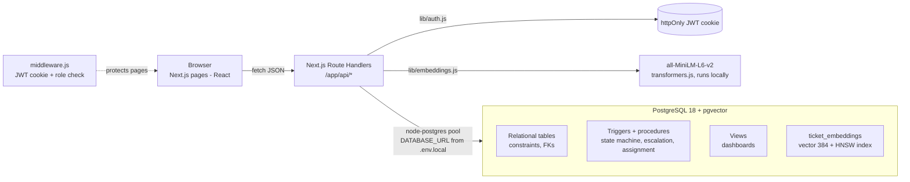
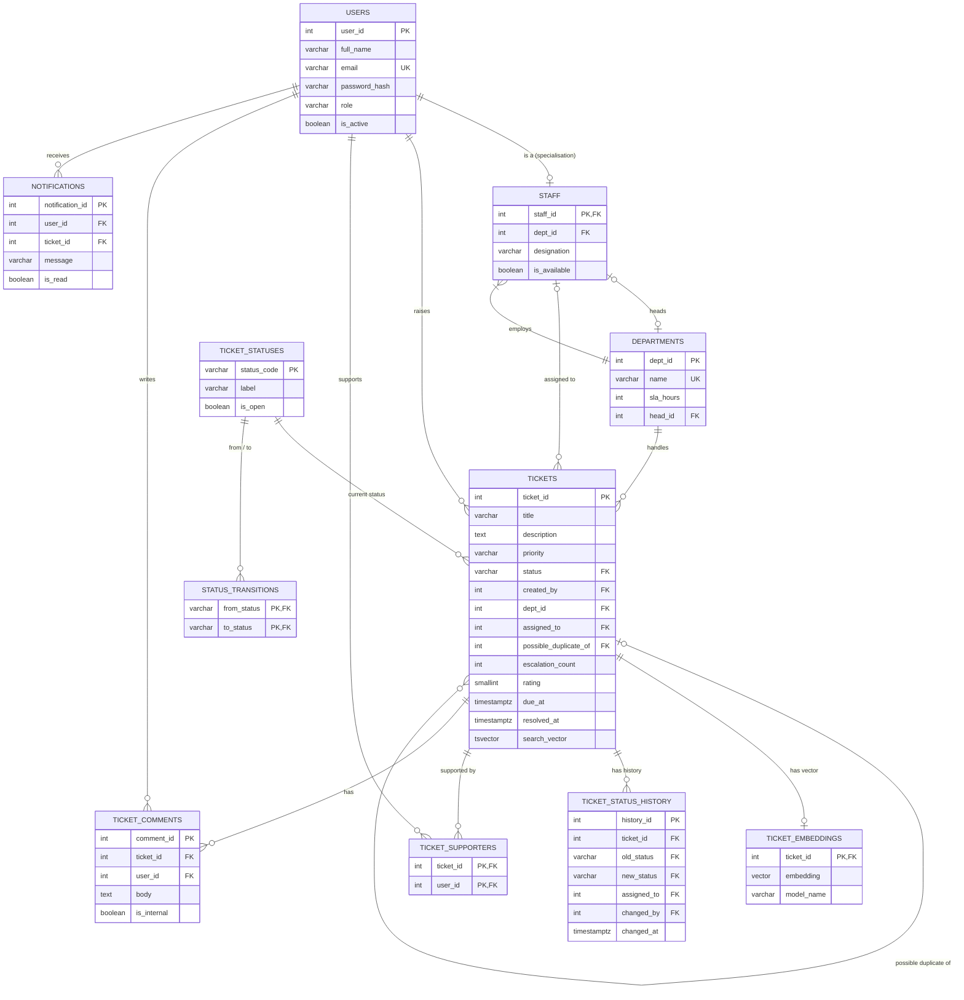
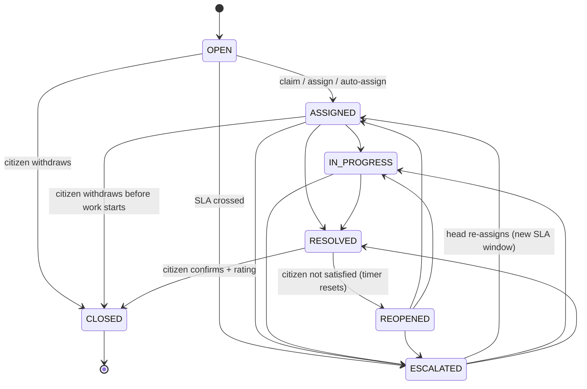

# Smart Grievance Redressal System – Design Document

**Team:** Krishna Tejas Voruganti (PES1UG24AM436), Sidhant Holla (PES1UG24AM466)

---

## 1. Problem Statement

Grievance redressal in universities is mostly handled through email, paper forms or basic complaint portals. These only *record* complaints:

- routing to the correct department is manual,
- many students report the same issue separately and each report is treated as a new case,
- complaints that stay unresolved are only noticed when someone follows up.

The data is there, but no process is enforced around it.

## 2. Objectives

1. Make the complaint **lifecycle** the core of the system: every ticket moves through fixed states, and the database rejects invalid moves.
2. **Escalate automatically** when a ticket crosses its department's SLA, and notify the department head.
3. Detect **near-duplicate complaints** at submission time, even when they are worded differently, and **suggest the department** from similar past cases.
4. Handle **concurrent actions** safely, e.g. two staff members picking up the same ticket.
5. Give heads and admins **dashboards** built on correct aggregate queries.

## 3. Scope

**In scope:** citizen sign-up and login, ticket submission with duplicate check, a staff queue, assignment and resolution, reopen and close with rating, SLA escalation, notifications, department and admin dashboards, user and department management, keyword and semantic search.

**Out of scope:** email/SMS delivery, file attachments, transferring a ticket to another department after submission, and a mobile app.

## 4. Functional Requirements

| Role | Can do |
|---|---|
| **Citizen** (student) | Register freely / login; raise a complaint; see similar open complaints and "support" one instead of filing a duplicate; track own and supported tickets and get notified of status changes; comment; withdraw a ticket until work has started; close a RESOLVED ticket with a rating or reopen it with a reason |
| **Staff** | See their department's queue (assigned to me / unassigned / all); pick up an unassigned ticket; start work; resolve with a note; comment (public or internal); set availability for auto-assignment; keyword and semantic search |
| **Department Head** | Everything staff can do, plus assign or re-assign tickets to department staff, resolve escalated tickets, and view the department dashboard (stats, workload, needs-attention list, slow tickets) |
| **Admin** | System dashboard (all departments, weekly trend, SLA-missing departments, most reported issues, top staff); browse all tickets; create departments and change SLA/head; create staff/head/admin users; deactivate users; run the escalation check manually |

Minimum 2 roles required – we have 4.

## 5. System Architecture

- **Frontend:** Next.js 14 (App Router), plain React client components, plain CSS.
- **Backend:** Next.js Route Handlers (`app/api/**/route.js`). All SQL is parameterised (`$1, $2 ...`).
- **Database:** PostgreSQL 18 with the pgvector 0.8.1 extension.
- **Embeddings:** `Xenova/all-MiniLM-L6-v2` through `@xenova/transformers`. It runs inside Node, so it needs no API key and no data leaves the machine.

## 6. ER Diagram

### Key design decisions

1. **Status on the ticket *and* a separate history table.** The current status sits on `tickets` because every dashboard and queue filters on it, and reading it from history would need a "latest row per ticket" subquery every time. The full timeline goes in `ticket_status_history`, which **only a trigger writes to**, so the two can never disagree.
2. **Workflow stored as data.** The allowed moves live in `status_transitions` (17 rows), and the trigger only checks that `(old, new)` exists in that table. Changing the workflow means changing rows, not code.
3. **STAFF as a specialisation of USERS.** Only staff and heads have a department. Putting `dept_id` on `users` would leave it NULL for every citizen and admin. `staff.staff_id` is both the PK and an FK to `users` (a 1:1 "is-a" relationship).
4. **Circular FK between DEPARTMENTS and STAFF.** A department has a head (a staff member), and a staff member belongs to a department. Neither FK can be created first, so `departments.head_id` is added afterwards with `ALTER TABLE`.
5. **Supporters instead of duplicate tickets.** "I have the same problem" is an M:N relationship (`ticket_supporters`, composite PK). It stops the same issue from being filed again and again, and it shows how many people are affected.
6. **Embeddings in their own table.** This keeps `tickets` narrow for the queues and dashboards, and separates the vector part of the design clearly.

## 7. Relational Schema

Underline = primary key, *italics* = foreign key.

- **departments** (<u>dept_id</u>, name, description, sla_hours, *head_id* → staff.staff_id, created_at)
- **users** (<u>user_id</u>, full_name, email, password_hash, role, is_active, created_at)
- **staff** (<u>*staff_id*</u> → users.user_id, *dept_id* → departments, designation, is_available)
- **ticket_statuses** (<u>status_code</u>, label, is_open, sort_order)
- **status_transitions** (<u>*from_status*</u>, <u>*to_status*</u>) → ticket_statuses
- **tickets** (<u>ticket_id</u>, title, description, location, priority, *status* → ticket_statuses, *created_by* → users, *dept_id* → departments, *assigned_to* → staff, *possible_duplicate_of* → tickets, escalation_count, rating, due_at, resolved_at, created_at, updated_at, *updated_by* → users, search_vector)
- **ticket_embeddings** (<u>*ticket_id*</u> → tickets, embedding, model_name, created_at)
- **ticket_status_history** (<u>history_id</u>, *ticket_id* → tickets, *old_status*, *new_status* → ticket_statuses, *assigned_to* → staff, *changed_by* → users, changed_at)
- **ticket_supporters** (<u>*ticket_id*</u>, <u>*user_id*</u>, supported_at)
- **ticket_comments** (<u>comment_id</u>, *ticket_id*, *user_id*, body, is_internal, created_at)
- **notifications** (<u>notification_id</u>, *user_id*, *ticket_id*, message, is_read, created_at)

**Normalisation:** all tables are in 3NF. Every non-key attribute depends only on the key. Department names, status labels and user names are stored once and joined in when needed, never copied into `tickets`. The two deliberate redundancies are:

- `tickets.status`, which duplicates the latest history row (see decision 1, kept consistent by a trigger),
- `tickets.escalation_count`, which could be counted from history. It is kept on the ticket so the dashboards don't need a join that would multiply rows (section 11).

## 8. Data Dictionary

### departments
| Column | Type | Constraints | Description |
|---|---|---|---|
| dept_id | SERIAL | PK | |
| name | VARCHAR(80) | NOT NULL, UNIQUE | |
| description | TEXT | | What the department handles |
| sla_hours | INT | NOT NULL, DEFAULT 72, CHECK 1–720 | Hours before an unresolved ticket escalates |
| head_id | INT | FK → staff ON DELETE SET NULL; trigger: must be a dept_head of this department | |
| created_at | TIMESTAMPTZ | NOT NULL DEFAULT now() | |

### users
| Column | Type | Constraints | Description |
|---|---|---|---|
| user_id | SERIAL | PK | |
| full_name | VARCHAR(100) | NOT NULL, CHECK length ≥ 2 | |
| email | VARCHAR(120) | NOT NULL, CHECK regex, UNIQUE on lower(email) | Login id; case-insensitive unique |
| password_hash | VARCHAR(100) | NOT NULL, CHECK bcrypt format | bcrypt hash (10 rounds); a plain password is rejected |
| role | VARCHAR(20) | NOT NULL, CHECK IN (citizen, staff, dept_head, admin) | |
| is_active | BOOLEAN | NOT NULL DEFAULT TRUE | Deactivated users cannot log in |
| created_at | TIMESTAMPTZ | NOT NULL | |

### staff
| Column | Type | Constraints | Description |
|---|---|---|---|
| staff_id | INT | PK, FK → users ON DELETE CASCADE; trigger: user role must be staff/dept_head | |
| dept_id | INT | NOT NULL, FK → departments ON DELETE RESTRICT | |
| designation | VARCHAR(60) | NOT NULL | |
| is_available | BOOLEAN | NOT NULL DEFAULT TRUE | Auto-assign skips unavailable staff |

### ticket_statuses / status_transitions
| Column | Type | Constraints | Description |
|---|---|---|---|
| status_code | VARCHAR(20) | PK | OPEN, ASSIGNED, IN_PROGRESS, ESCALATED, REOPENED, RESOLVED, CLOSED |
| label | VARCHAR(40) | NOT NULL | Display name |
| is_open | BOOLEAN | NOT NULL | TRUE = still needs work |
| from_status, to_status | VARCHAR(20) | composite PK, both FK → ticket_statuses, CHECK from ≠ to | One row per allowed move |

### tickets
| Column | Type | Constraints | Description |
|---|---|---|---|
| ticket_id | SERIAL | PK | |
| title | VARCHAR(150) | NOT NULL, CHECK length ≥ 5 | |
| description | TEXT | NOT NULL, CHECK length ≥ 20 | |
| location | VARCHAR(120) | | Optional block/room |
| priority | VARCHAR(10) | NOT NULL DEFAULT MEDIUM, CHECK IN (LOW, MEDIUM, HIGH) | HIGH halves the SLA |
| status | VARCHAR(20) | NOT NULL DEFAULT OPEN, FK → ticket_statuses | Changes validated by trigger |
| created_by | INT | NOT NULL, FK → users ON DELETE RESTRICT | |
| dept_id | INT | NOT NULL, FK → departments ON DELETE RESTRICT; trigger: cannot change | |
| assigned_to | INT | FK → staff ON DELETE SET NULL; trigger: must be in same department | |
| possible_duplicate_of | INT | FK → tickets (self), CHECK ≠ ticket_id | Set when an open ticket with similarity ≥ 0.60 exists |
| escalation_count | INT | NOT NULL DEFAULT 0, CHECK ≥ 0 | Incremented by trigger |
| rating | SMALLINT | CHECK 1–5, CHECK only when CLOSED | Citizen feedback |
| due_at | TIMESTAMPTZ | set by trigger | SLA deadline |
| resolved_at | TIMESTAMPTZ | CHECK ≥ created_at; CHECK NOT NULL when RESOLVED | |
| created_at / updated_at | TIMESTAMPTZ | NOT NULL | |
| updated_by | INT | FK → users | Who made the last change (NULL = system); copied into history |
| search_vector | TSVECTOR | GENERATED ALWAYS AS (title + description) STORED | For full-text search |
| | | CHECK: ASSIGNED / IN_PROGRESS need assigned_to | |

### ticket_embeddings (vector store)
| Column | Type | Constraints | Description |
|---|---|---|---|
| ticket_id | INT | PK, FK → tickets ON DELETE CASCADE | 1:1 with tickets |
| embedding | VECTOR(384) | NOT NULL, HNSW index (vector_cosine_ops) | MiniLM sentence embedding of "title. description" |
| model_name | VARCHAR(60) | NOT NULL | Stored so vectors from different models are never compared |
| created_at | TIMESTAMPTZ | NOT NULL | |

### ticket_status_history, ticket_supporters, ticket_comments, notifications
| Table | Important constraints |
|---|---|
| ticket_status_history | FK ticket (CASCADE), FK statuses, FK changed_by (SET NULL; NULL = system). Written only by trigger |
| ticket_supporters | Composite PK (ticket_id, user_id), so a user can support a ticket only once |
| ticket_comments | CHECK body length 1–2000; is_internal hides it from citizens |
| notifications | Partial index on (user_id) WHERE is_read = FALSE for the unread badge |

## 9. Database Choice and Justification

| Data | Nature | Where | Why |
|---|---|---|---|
| Users, departments, staff, tickets, history, comments, supporters | Structured, related, needs integrity | **PostgreSQL (relational)** | Foreign keys, CHECK constraints, transactions and row-level locks are needed. Two staff acting on one ticket must not both succeed, and a ticket must never point at a deleted department. A document store would leave these rules to the application. |
| Complaint text (meaning) | Unstructured natural language | **pgvector (vector)** | Complaints about the same issue are rarely worded the same way ("lift not working" vs "elevator stuck" share no keywords). Keyword search can't match them, but cosine similarity between sentence embeddings can. |
| Complaint text (exact words) | Text | **PostgreSQL full-text search** (tsvector + GIN) | Staff sometimes search for an exact word or room number, and FTS is better for that. |

**Why pgvector instead of a separate vector database (Qdrant/Pinecone):** the vectors are always used together with relational filters (only *open* tickets, only *resolved/accepted* tickets, joined to the department name). Keeping them in the same database means:

- a single SQL query can do the similarity search together with the JOIN and WHERE filters,
- the vector is inserted in the **same transaction** as the ticket, so a ticket is never saved without its embedding (if the model cannot load, the submission is refused with a clear message),
- there's one fewer service to run and keep in sync.

At our data size (thousands of tickets, not millions) a dedicated vector database would add complexity without any benefit.

## 10. Ticket Lifecycle and Escalation Rules

Rules we fixed before writing the triggers:

1. `due_at = opened time + department SLA`. **HIGH** priority gets **half** the SLA.
2. If a ticket is still OPEN / ASSIGNED / IN_PROGRESS / REOPENED after `due_at`, it becomes **ESCALATED**. The **department head is notified**, and the assignee stays the same.
3. When the head re-assigns an escalated ticket, a **fresh SLA window** starts. If it breaches again (`escalation_count ≥ 2`), the **admins are notified too**.
4. **Reopening resets the timer** to a full SLA window and clears `resolved_at`.
5. The timer stops at RESOLVED. CLOSED tickets are read-only.

**Where the escalation check runs:** PostgreSQL triggers only fire on INSERT/UPDATE, not with the passage of time. So `escalate_overdue_tickets()` is called by the app before queues and dashboards load (at most once a minute), and the admin can also run it from the dashboard. All the side effects (history, `escalation_count`, notifications) come from the triggers, so it doesn't matter who calls the function. In production we would schedule it with `pg_cron`.

## 11. Advanced Database Features Used

| Feature | Where | File |
|---|---|---|
| **Triggers** | `ticket_before_insert` (force OPEN, compute due_at), `ticket_before_update` (state machine, closed = read-only, same-department assignee, resolved_at / due_at / escalation_count), `ticket_after_change` (history + notifications), `staff_role_check`, `department_head_check` | `db/03_functions_triggers.sql` |
| **Stored procedures** | `claim_ticket`, `assign_ticket`, `auto_assign_ticket` (least loaded available staff via `v_staff_workload`) | same |
| **Functions** | `compute_due_at`, `escalate_overdue_tickets`, `find_similar_tickets`, `suggest_department` | same |
| **Transactions + row locks** | Every ticket action runs in `BEGIN … COMMIT` with `SELECT … FOR UPDATE`. Ticket + embedding + auto-assign are inserted in one transaction, and so are user + staff rows | `lib/db.js`, `app/api/tickets/**` |
| **Views** | `v_ticket_details`, `v_department_stats`, `v_staff_workload` | `db/02_views.sql` |
| **Indexing** | composite `(dept_id, status)`, partial `due_at WHERE open`, expression `UNIQUE lower(email)`, GIN on tsvector, HNSW on vectors, partial unread notifications | `db/01_schema.sql` |
| **Full-text search** | generated `tsvector` column + GIN, `plainto_tsquery`, `ts_rank` | keyword search mode |
| **Vector similarity search** | `<=>` cosine distance, HNSW index | duplicate check, department suggestion, semantic search |

**Concurrency, two staff picking up the same ticket.** Without a lock, both read `OPEN`, both update, and the second update silently overwrites the first. `claim_ticket` locks the row with `SELECT … FOR UPDATE`. The second transaction waits, then sees `ASSIGNED` and fails with *"Ticket #N was already picked up by someone else"*. Both behaviours are shown in the test script (section 13).

**Counting correctly.** Joining `tickets` with `ticket_status_history` repeats each ticket once per history row: for IT that gives 34 rows for 8 tickets. So `v_department_stats` counts from `tickets` only (using `escalation_count` instead of joining history), and the weekly trend uses two separate scalar subqueries instead of one join.

## 12. Vector / Semantic Search Component

| Question | Answer |
|---|---|
| What is embedded | `title + ". " + description` of every ticket, at submission time. Search text in semantic search mode is embedded on the fly. |
| Model | `sentence-transformers/all-MiniLM-L6-v2` (ONNX version `Xenova/all-MiniLM-L6-v2`), run locally with transformers.js. Mean pooling + L2 normalisation gives a **384-dim** unit vector. It is small (~23 MB), fast on a CPU and free, and it is trained for exactly this kind of sentence-similarity task. |
| How it is stored | `ticket_embeddings.embedding VECTOR(384)`, 1:1 with tickets, inserted in the same transaction as the ticket. `model_name` is stored too. |
| Index | HNSW with `vector_cosine_ops` |
| Similarity metric | **Cosine similarity** = `1 - (a <=> b)`. Vectors are normalised, so this only compares direction (meaning), not text length. |
| Retrieval 1: duplicates | `find_similar_tickets(vec, min_sim, limit)` searches **open** tickets ordered by distance. On the form we show ≥ 0.50 and the citizen decides. On submit, if the best match is ≥ 0.60 it is saved as `possible_duplicate_of`. |
| Retrieval 2: department | `suggest_department(vec, k=7, min_sim=0.4)` takes the 7 nearest tickets that a department is **handling or has resolved** (not unassigned or withdrawn ones), and each votes for its department weighted by similarity (`GROUP BY dept, SUM(sim)`). |
| Retrieval 3: search | Staff and admin can switch the search box to semantic mode (results ≥ 0.3, ranked by distance). |

### Tuning on our own data

The functions always return *something*, so we checked the scores by hand:

| Pair | Same issue? | Cosine similarity |
|---|---|---|
| "Wi-Fi not working in hostel block C" / "Internet keeps disconnecting in C block" | yes | 0.644 |
| "Water leakage in classroom" / "Roof leaking in room 204" | yes | 0.677 |
| "Lift not working in new block" / "Elevator stuck in the new building" | yes | **0.611** |
| "Internet very slow in hostel at night" / "No internet connection in my hostel room" | yes | 0.713 |
| "Route 7 bus skipped my stop" / "College bus late every morning" | no (related) | 0.606 |
| "Canteen food stale" / "Mess food spoiled" | no (different place) | 0.556 |
| "Exam results not published" / "Marks not updated on portal" | no | 0.433 |
| "Wi-Fi not working" / "Bus was late" | no | 0.233 |

- We first used **0.65** as the duplicate threshold, but it **missed the lift/elevator pair (0.611)**. We lowered it to **0.60**: a wrong "possible duplicate" note costs staff a click, while a missed duplicate means the same work gets done twice. Only *open* tickets are compared, so the bus pair (0.606) is not flagged, because the old bus ticket is closed.
- `suggest_department` with all 7 neighbours voting sent "fan making noise in classroom" to *Hostel*. Its nearest match was correct (Maintenance, 0.66), but three weak hostel matches (0.27–0.48) outvoted it. Adding `min_similarity = 0.4` fixed this.
- It also sent "WiFi down in my hostel" to *Hostel* when only resolved tickets were used, because IT had just one resolved Wi-Fi case. Including tickets the department is currently handling fixed it. Most tickets are auto-assigned, so this means "not rejected", not "confirmed correct by staff".
- **Known limitation:** ambiguous text like "water cooler not working in library block" still goes to Hostel, because there's no similar past case. The suggestion is only pre-selected in a dropdown, and the citizen can change it.

## 13. Security

- Passwords are stored only as **bcrypt** hashes, and a CHECK constraint rejects anything that is not one. The minimum length (8) is checked in the API, because the database never sees the plain password.
- **Registering a privileged role needs an access code.** Anyone can register as a citizen, but staff, head and admin sign-ups must give `STAFF_SIGNUP_CODE`, which is kept in `.env.local` and checked on the server. Otherwise anyone who opened the site could make themselves an admin. If the code is not set, those sign-ups are turned off, and an admin can still create accounts from the Users page.
- The login session is a **JWT in an httpOnly, SameSite=Lax cookie** (8 h expiry), so JavaScript in the page can't read it.
- **Role checks happen twice:** `middleware.js` for pages, and `requireRole()` in every API route. Data scoping happens in SQL: staff only see their department, citizens only see their own and supported tickets, and citizens never get internal notes.
- **All queries are parameterised** (`$1, $2`), so user input is never concatenated into SQL.
- `DATABASE_URL` and `JWT_SECRET` come from `.env.local`, which is git-ignored. The app connects as `grievance_app`, a normal role that owns its database, not the postgres superuser.
- Login gives the same error for an unknown email and a wrong password.
- Users are deactivated, not deleted, so their history stays intact.
- The role is stored in the login cookie, so a change to a user's role or active status only takes effect at their next login (at most 8 hours later).

## 14. Testing

See [TESTING.md](TESTING.md): 36 automated database tests plus manual API/UI tests.

## 15. Conclusion and Future Enhancements

The workflow is enforced inside PostgreSQL, so even a direct SQL `UPDATE` can't skip a step, assign across departments or edit a closed ticket. The vector component deals with the "same problem, different words" case, which keyword search cannot.

Future work:

- schedule `escalate_overdue_tickets()` with **pg_cron** instead of calling it from the app,
- email/SMS notifications,
- image attachments,
- department transfer with its own transition rules,
- re-embedding when the model changes (`model_name` is already stored),
- clustering open tickets to find campus-wide issues automatically.
