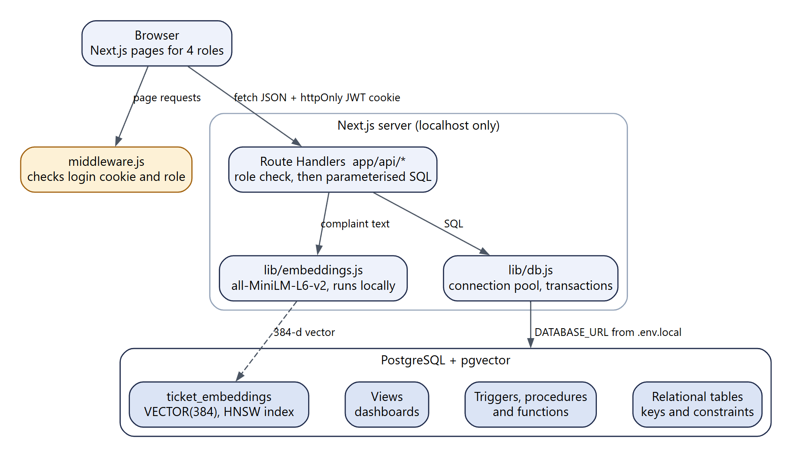

# Project overview

**Smart Grievance Redressal System**, DBMS Experiential Learning Level 3 project.

**Team:** Krishna Tejas Voruganti (PES1UG24AM436), Sidhant Holla (PES1UG24AM466)

## Problem Statement

Grievance redressal in universities is mostly handled through email, paper forms or basic complaint portals. These only *record* complaints:

- routing to the correct department is manual,
- many students report the same issue separately and each report is treated as a new case,
- complaints that stay unresolved are only noticed when someone follows up.

The data is there, but no process is enforced around it.

## Objectives

1. Make the complaint **lifecycle** the core of the system: every ticket moves through fixed states, and the database rejects invalid moves.
2. **Escalate automatically** when a ticket crosses its department's SLA, and notify the department head.
3. Detect **near-duplicate complaints** at submission time, even when they are worded differently, and **suggest the department** from similar past cases.
4. Handle **concurrent actions** safely, e.g. two staff members picking up the same ticket.
5. Give heads and admins **dashboards** built on correct aggregate queries.

## Scope

**In scope:** citizen sign-up and login, ticket submission with duplicate check, a staff queue, assignment and resolution, reopen and close with rating, SLA escalation, notifications, department and admin dashboards, user and department management, keyword and semantic search.

**Out of scope:** email/SMS delivery, file attachments, transferring a ticket to another department after submission, and a mobile app.

## Functional Requirements

| Role | Can do |
|---|---|
| **Citizen** (student) | Register freely / login; raise a complaint; see similar open complaints and "support" one instead of filing a duplicate; track own and supported tickets, get notified of status changes, and stop following a ticket; comment; withdraw a ticket until work has started; close a RESOLVED ticket with a rating or reopen it with a reason |
| **Staff** | See their department's queue (assigned to me / unassigned / all); pick up an unassigned ticket; start work; resolve with a note; comment (public or internal); set availability for auto-assignment; keyword and semantic search |
| **Department Head** | Everything staff can do, plus assign or re-assign tickets to department staff, resolve escalated tickets, and view the department dashboard (stats, workload, needs-attention list, slow tickets) |
| **Admin** | System dashboard (all departments, weekly trend, SLA-missing departments, most reported issues, top staff); browse all tickets; create departments and change SLA/head; create staff/head/admin users; deactivate users; run the escalation check manually |

Minimum 2 roles required – we have 4.

## System Architecture

- **Frontend:** Next.js 14 (App Router), plain React client components, plain CSS.
- **Backend:** Next.js Route Handlers (`app/api/**/route.js`). All SQL is parameterised (`$1, $2 ...`).
- **Database:** PostgreSQL 18 with the pgvector 0.8.1 extension.
- **Embeddings:** `Xenova/all-MiniLM-L6-v2` through `@xenova/transformers`. It runs inside Node, so it needs no API key and no data leaves the machine.

## Conclusion and Future Enhancements

The workflow is enforced inside PostgreSQL, so even a direct SQL `UPDATE` can't skip a step, assign across departments or edit a closed ticket. The vector component deals with the "same problem, different words" case, which keyword search cannot.

Future work:

- schedule `escalate_overdue_tickets()` with **pg_cron** instead of calling it from the app,
- upgrade to a supported Next.js version and a newer embedding library, which clears the `npm audit` advisories, before hosting the app anywhere public,
- email/SMS notifications,
- image attachments,
- department transfer with its own transition rules,
- re-embedding when the model changes (`model_name` is already stored),
- clustering open tickets to find campus-wide issues automatically.

