# Application screenshots

## Landing page

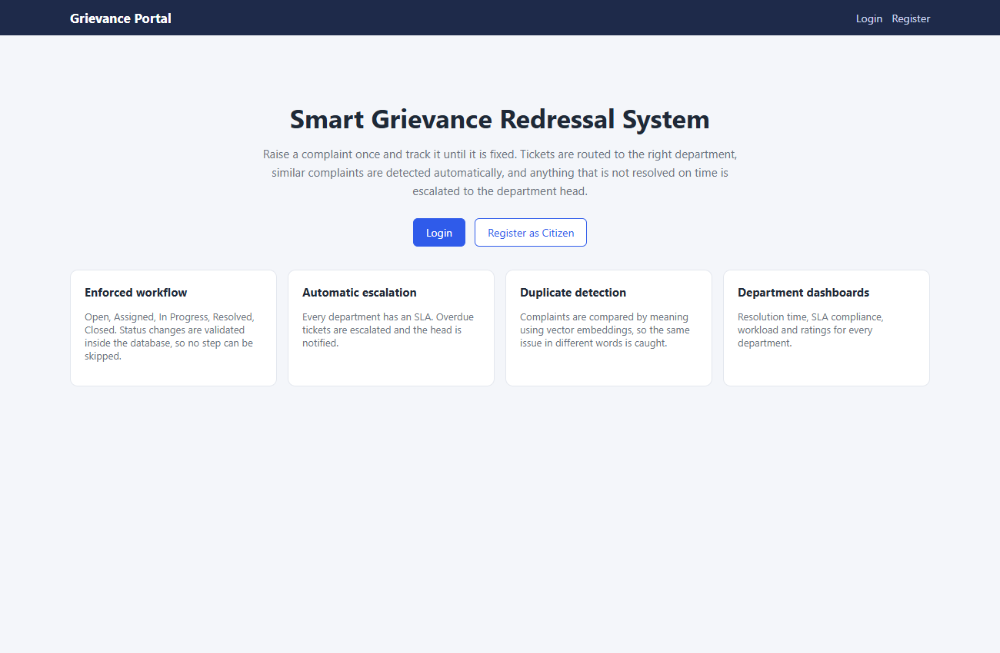

## Login

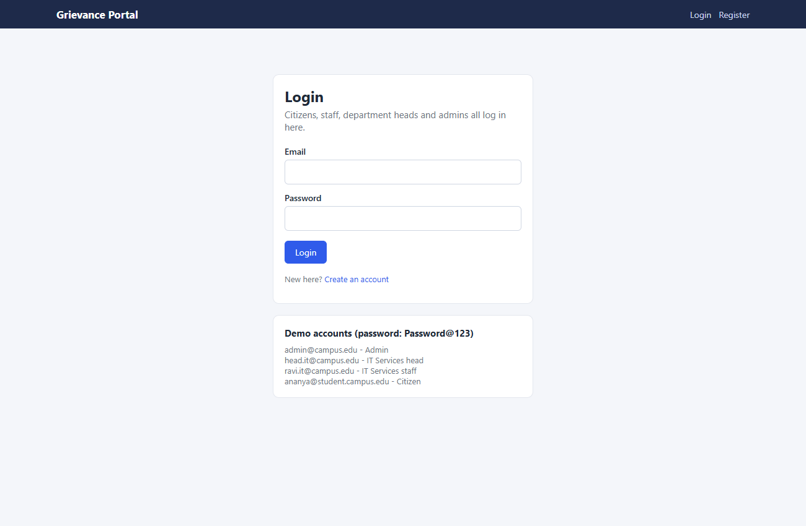

## Register, with all account types

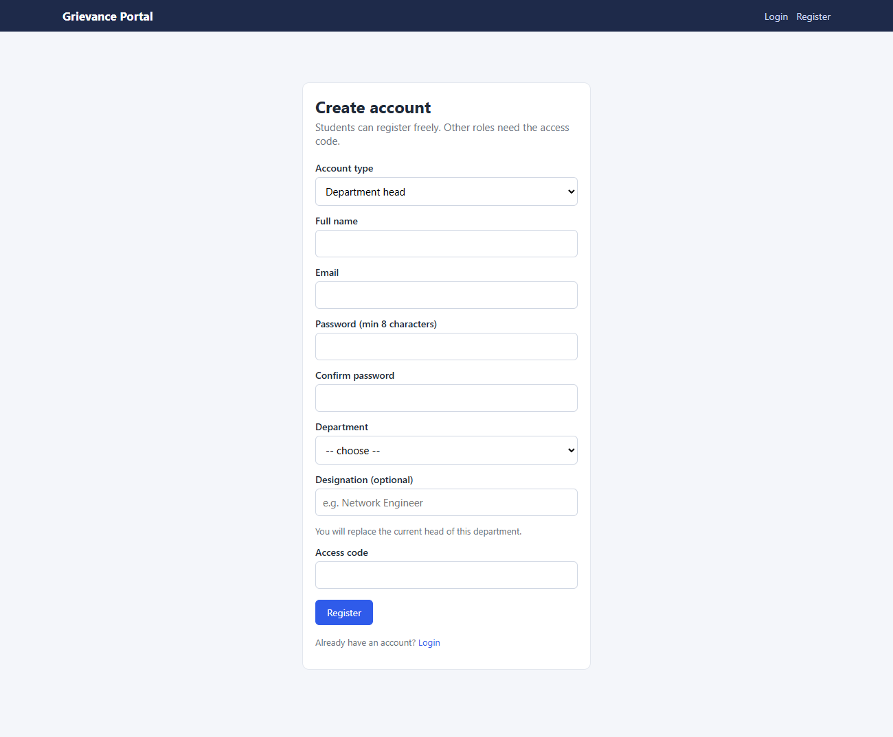

## Citizen: my tickets

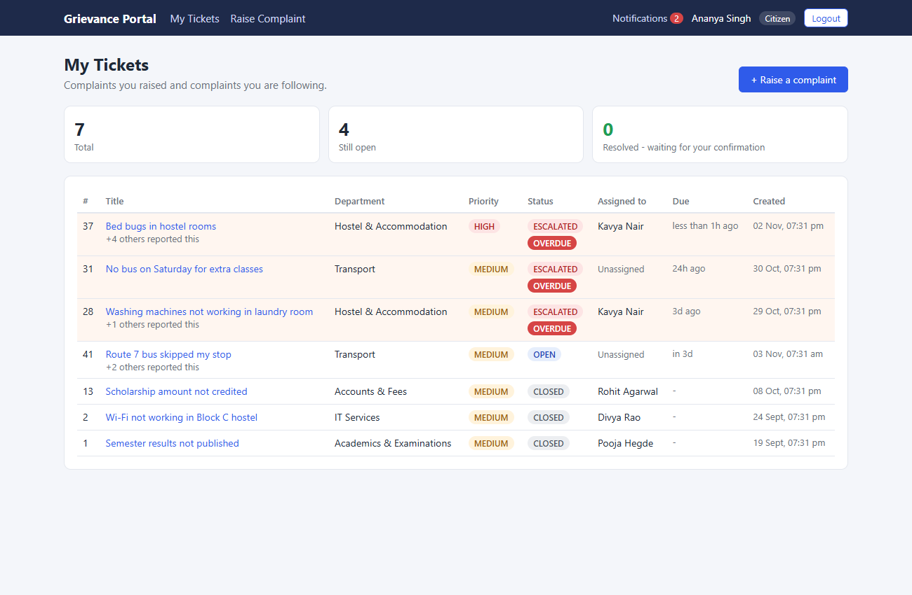

## Citizen: duplicate check and department suggestion

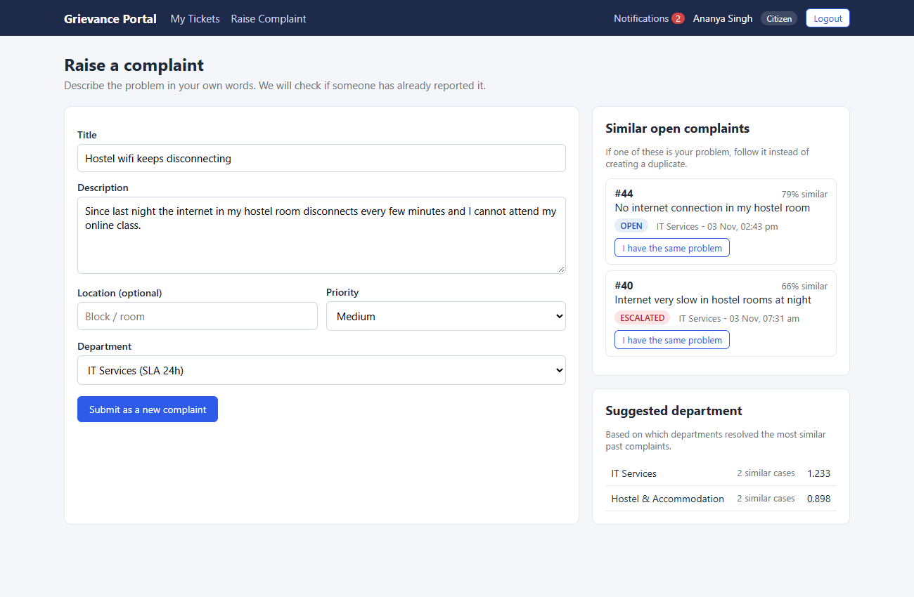

## Citizen: a followed ticket, with "Stop following"

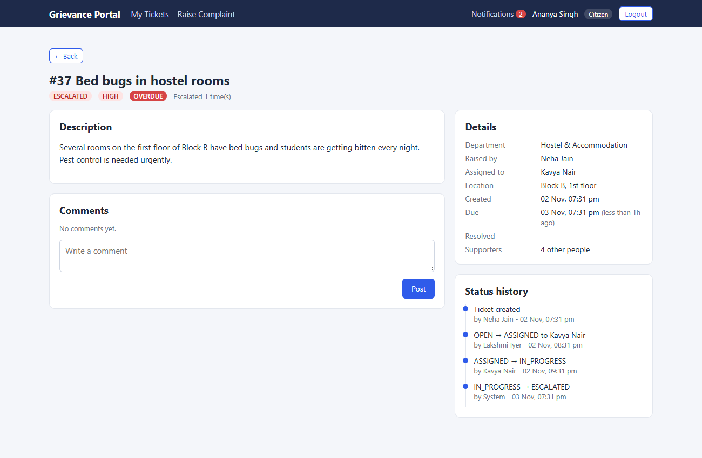

## Staff: ticket queue

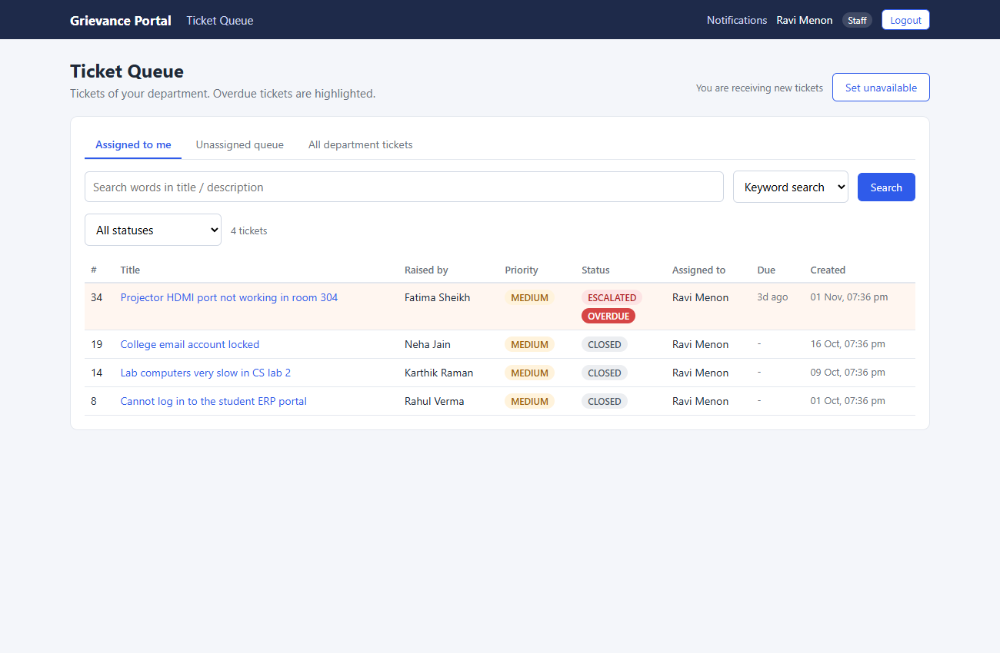

## Staff: semantic search

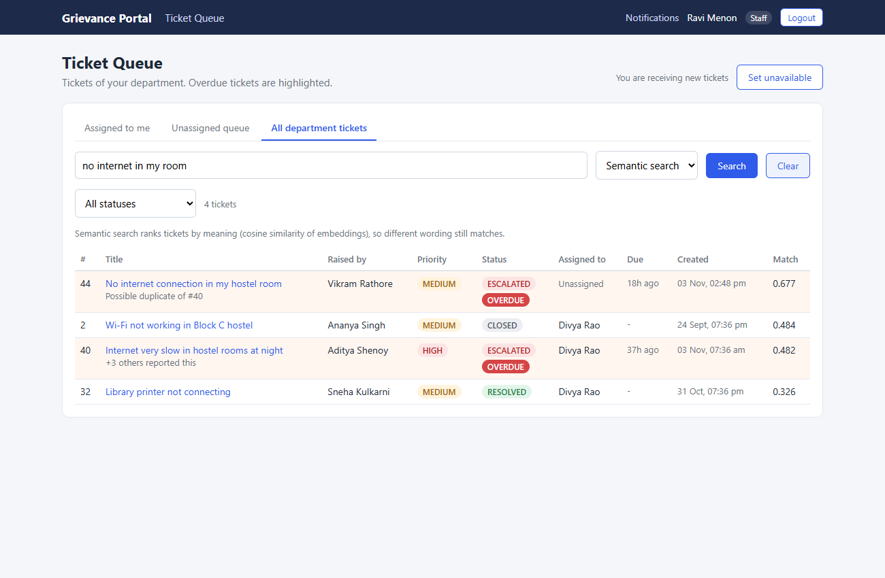

## Department head dashboard

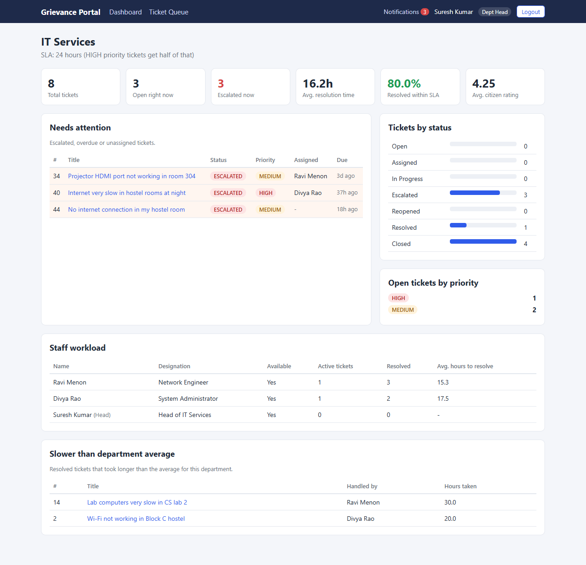

## Ticket detail with assignment and status history

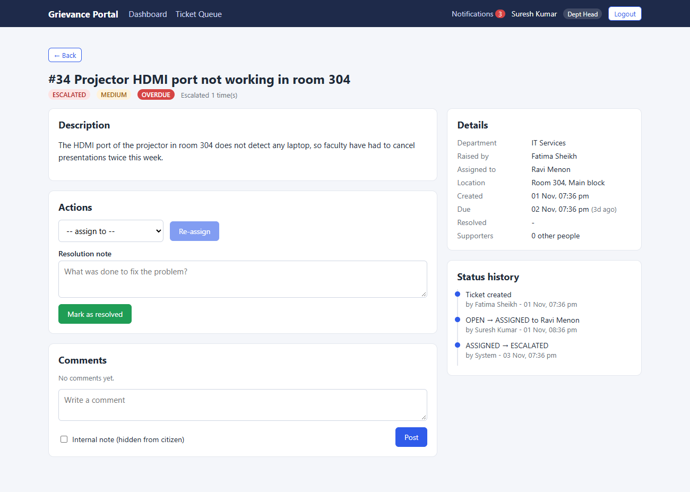

## Admin dashboard

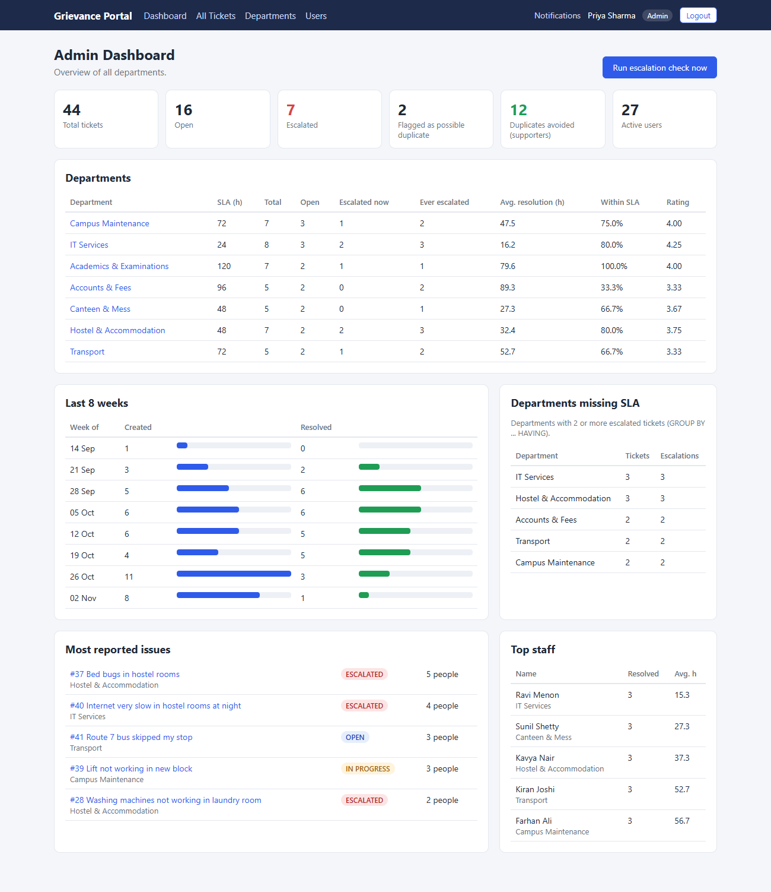

## Admin: manage departments

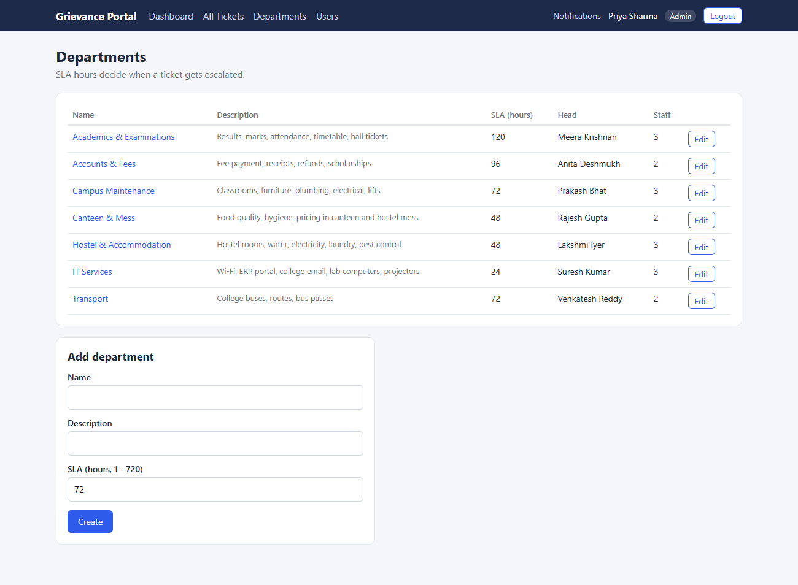

## Admin: manage users

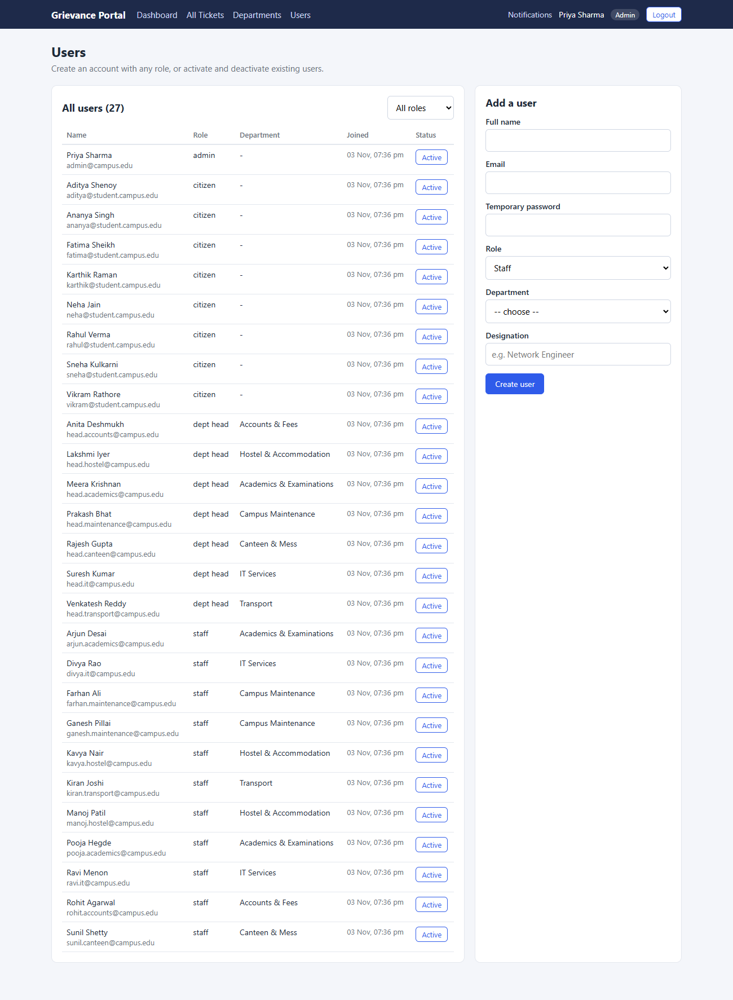

## Notifications created by triggers

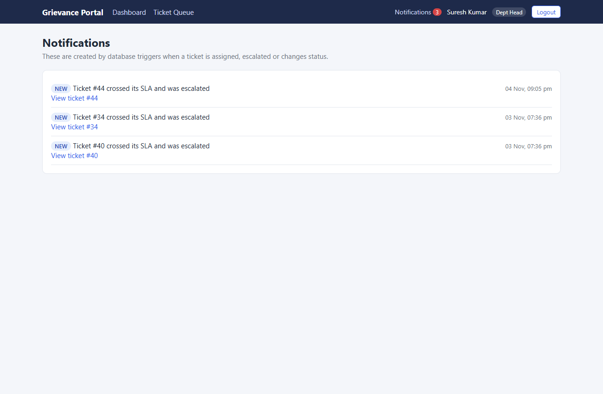

