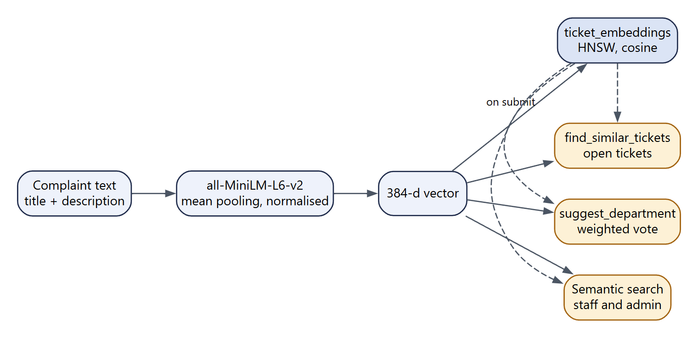

# Vector database and semantic search

## The problem it solves

Students describe the same issue in different words. One writes "Lift not working in new block" and another writes "Elevator stuck in the new building". The two sentences share almost no keywords, so a text search treats them as unrelated and the same problem gets filed twice.

Comparing the **meaning** of complaints fixes this. Each complaint becomes a vector, and similar complaints have vectors that point in nearly the same direction.



## 1. What is converted into embeddings

The text `title + ". " + description` of every ticket, when it is submitted. Text typed into semantic search is embedded the same way. The title and description are combined so that a short title still has context.

## 2. Embedding model

| Item | Choice |
|---|---|
| Model | `all-MiniLM-L6-v2` (ONNX version `Xenova/all-MiniLM-L6-v2`) |
| Runs through | `@xenova/transformers`, inside Node |
| Output | 384 dimensions, mean pooling, L2 normalised |
| Size | About 23 MB, downloaded once and cached |

We chose it because it is trained for sentence similarity, runs on a normal laptop CPU, is free, needs no API key, and means complaint text never leaves the machine.

## 3. How vectors are stored

```sql
CREATE TABLE ticket_embeddings (
    ticket_id   INT PRIMARY KEY REFERENCES tickets(ticket_id) ON DELETE CASCADE,
    embedding   VECTOR(384) NOT NULL,
    model_name  VARCHAR(60) NOT NULL DEFAULT 'all-MiniLM-L6-v2',
    created_at  TIMESTAMPTZ NOT NULL DEFAULT now()
);

CREATE INDEX idx_embeddings_hnsw ON ticket_embeddings
    USING hnsw (embedding vector_cosine_ops);
```

| Part of the design | Reason |
|---|---|
| One row per ticket | `ticket_id` is the primary key, so each ticket has exactly one vector |
| `ON DELETE CASCADE` | The vector is removed with its ticket |
| `model_name` metadata | Vectors from different models must never be compared |
| Same transaction as the ticket | A ticket is never saved without its vector. If the model cannot load, the submission is refused with a clear message |
| HNSW index | Fast approximate nearest-neighbour search, with `vector_cosine_ops` to match our metric |

## 4. Similarity metric

**Cosine similarity**, written as `1 - (a <=> b)`, where `<=>` is pgvector's cosine distance operator. The vectors are normalised, so this compares direction (meaning) and ignores text length.

## 5. How relevant results are retrieved

### a) Duplicate check: `find_similar_tickets(vector, min_similarity, limit)`

Searches **open** tickets, closest first. On the form we show matches of 0.50 and above, and the citizen decides. On submit, if the best match is 0.60 or above, it is saved as `possible_duplicate_of` so staff can see it.

### b) Department suggestion: `suggest_department(vector, k, min_similarity)`

Takes the 7 nearest tickets that a department is handling or has resolved, ignores anything below 0.40, and lets each one vote for its department, weighted by similarity. It uses `GROUP BY dept` with `SUM(similarity)`, and the top department is pre-selected on the form.

### c) Semantic search

Staff and admins can switch the search box to semantic mode. Results at 0.30 or above are ranked by distance.

## 6. Tuning on our own data

These functions always return something, so a working query does not mean a useful result. We checked the scores by hand.

| Complaint pair | Same issue? | Cosine similarity |
|---|---|---|
| "Wi-Fi not working in hostel block C" / "Internet keeps disconnecting in C block" | Yes | 0.644 |
| "Water leakage in classroom" / "Roof leaking in room 204" | Yes | 0.677 |
| "Lift not working in new block" / "Elevator stuck in the new building" | Yes | **0.611** |
| "Internet very slow in hostel at night" / "No internet connection in my hostel room" | Yes | 0.713 |
| "Route 7 bus skipped my stop" / "College bus late every morning" | No, related | 0.606 |
| "Canteen food stale" / "Mess food spoiled" | No, different place | 0.556 |
| "Exam results not published" / "Marks not updated on portal" | No | 0.433 |
| "Wi-Fi not working" / "Bus was late" | No | 0.233 |

What we changed because of this:

- **Duplicate threshold lowered from 0.65 to 0.60.** 0.65 missed the lift and elevator pair. A wrong "possible duplicate" note costs staff a click, while a missed duplicate means the same work is done twice. Only open tickets are compared, so the bus pair is not flagged, because the older bus ticket is closed.
- **Minimum similarity of 0.40 added to the department vote.** "Fan making noise in classroom" had the right nearest match (Maintenance, 0.66), but three weak hostel matches outvoted it.
- **Tickets being handled now count, not only resolved ones.** "WiFi down in my hostel" went to Hostel because IT had just one resolved Wi-Fi case. Most tickets are auto-assigned, so this means "not rejected by the department", not "confirmed by staff".

**Known limitation:** ambiguous text like "water cooler not working in library block" still suggests Hostel, because no similar past case exists. The suggestion is only pre-selected, so the citizen can change it.

## Evidence

- Functions: `db/03_functions_triggers.sql`
- Embedding code: `lib/embeddings.js`
- Duplicate check API: `app/api/tickets/check/route.js`
- Vector tests: see the "Vector similarity" rows in [TEST_RESULTS_DB.md](TEST_RESULTS_DB.md)
